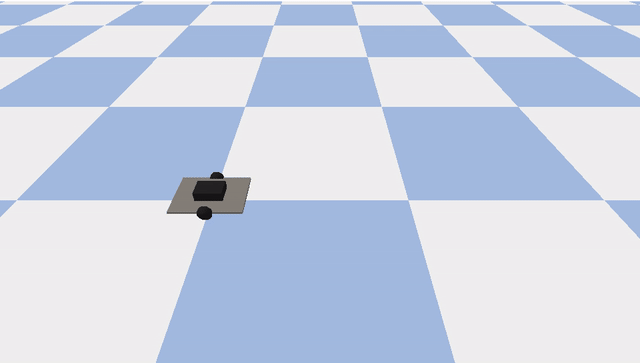
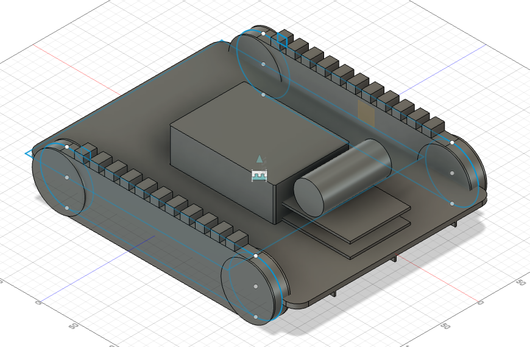
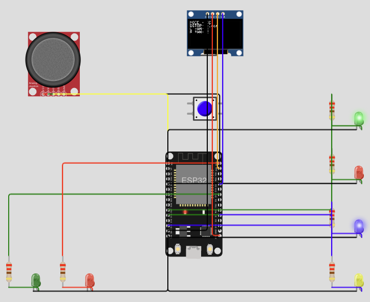

# Climbing Robot for Tower Inspection

**Simulation and control prototype for a crawler robot that inspects, cleans and maintains metal towers.**


<p align="center">
  
  <br><em>Drive test of the simplified model: forward, turn in place, forward on a new heading.</em>
</p>

---

## Overview

Wind turbine towers, transmission towers and other steel structures need regular inspection and cleaning. That work is usually done by people at height. This project explores a small tracked robot that can do it instead.

The concept has four parts:

| Part | Purpose |
| --- | --- |
| Two crawler tracks | Drive the robot and hold it to the steel surface using magnetic or vacuum adhesion |
| Central control unit | ESP32 controller, motor drivers and power |
| Removable brush module | Interchangeable tool for cleaning; other tools can mount in its place |
| Control modes | Remote control by an operator, or autonomous coverage of the tower surface |

This repository covers the parts built and tested in software so far: the CAD concept, a Gazebo simulation, motion scripts, a URDF description and the embedded controller.

## Mechanical design

<p align="center">
  
  <br><em>Assembly in Autodesk Fusion: two tracks, control unit, brush module and chassis.</em>
</p>

| Parameter | Value |
| --- | --- |
| Chassis | 360 x 260 x 12 mm |
| Track gauge (centre to centre) | 260 mm |
| Drive sprocket radius | 35 mm |
| Model mass | 2.5 kg |

## Embedded controller (ESP32)

<p align="center">
  
  <br><em>Controller circuit in Wokwi: joystick, mode and E-stop buttons, OLED status display and motor-channel indicators.</em>
</p>

**[Run the live simulation in your browser](https://wokwi.com/projects/473786583774125057)** (no hardware or install needed).

The sketch [`firmware/rc_controller/rc_controller.ino`](firmware/rc_controller/rc_controller.ino) shows one motor-drive path serving both modes:

- **Arcade mixing:** joystick throttle and turn become left and right motor PWM.
- **Mode switching:** a button toggles between remote control and an autonomous command sequence that stands in for the coverage planner.
- **Emergency stop:** applied last, after mixing and mode selection, so nothing upstream can bypass it.

LEDs represent the two motor channels because Wokwi has no built-in motor driver. To build the project yourself, create an ESP32 project at [wokwi.com](https://wokwi.com), paste in the sketch and add the libraries listed in `libraries.txt`.

## Gazebo simulation

The world contains a differential-drive model of the robot and a 3 m steel tower. The robot listens for velocity commands on `/cmd_vel` and publishes wheel odometry.

**Quick start** (Gazebo Sim installed):

```bash
cd gazebo
bash run_sim.sh          # coverage sweep
bash run_sim.sh drive    # simple drive test
```

`run_sim.sh` starts the server and GUI, waits for the robot to be ready, runs the chosen demo, then prints the robot's final position.

**Manual start** (three terminals):

```bash
export GZ_IP=127.0.0.1                          # run in each terminal
gz sim -s -r gazebo/climbing_robot_world.sdf    # 1. physics server
gz sim -g                                       # 2. GUI
bash gazebo/coverage_demo.sh                    # 3. motion script
```

The coverage demo drives a boustrophedon ("lawnmower") pattern: sweep a row, step over, sweep back. On a tower, the same pattern becomes sweeping one ring of the shell, stepping up one brush width, and sweeping the next.

## Repository layout

```
gazebo/
  climbing_robot_world.sdf   Robot and tower world
  test_diffdrive.sdf         Minimal world for testing the drive plugin
  run_sim.sh                 One-command launcher
  drive_demo.sh              Forward, turn in place, forward
  coverage_demo.sh           Three-row coverage sweep
urdf/
  climbing_robot.urdf        Robot description (ROS conventions: X forward, Z up)
firmware/rc_controller/
  rc_controller.ino          ESP32 remote/autonomous controller with E-stop
  libraries.txt              Wokwi library list
docs/                        Images used in this README
```

## Current limitations

- **Ground driving only.** The robot drives on flat ground around the tower. Driving up the tower face needs the track adhesion force modelled, which requires a custom Gazebo plugin.
- **Open-loop motion.** Turns are timed, not corrected using odometry, so the robot drifts over long runs.
- **No radio link yet.** The controller marks where an ESP-NOW receiver and a link-loss watchdog connect to the same safety gate as the E-stop.
- **Simplified model.** The simulation uses wheels and a box chassis in place of the full tracked CAD geometry.

## Roadmap

1. Closed-loop heading control using wheel odometry
2. Adhesion force plugin so the robot can drive on the tower face
3. ROS 2 node with a full coverage planner for cylindrical surfaces
4. Wireless link and watchdog on real ESP32 hardware

## Author

**Balkrishna Sedhain**
B.E. Electronics and Communication Engineering, Master of Information Systems
[LinkedIn](https://www.linkedin.com/in/balkrishnasedhain) · [GitHub](https://github.com/Balkrishna2021)
