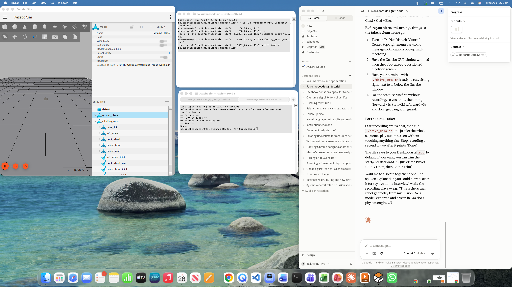

# Climbing Robot: Simulation and Control Prototype

A small prototype for a robot that inspects, cleans and maintains metal towers (for example wind turbine or transmission towers). The concept uses two crawler tracks with magnetic or vacuum adhesion, a central control unit, and a removable brush module.

This repository covers the parts I could build and test in software:

- a **Gazebo world** with a differential-drive model of the robot and a simulated tower
- **drive and coverage scripts** that send velocity commands to the robot
- a **URDF** description of the robot using standard ROS conventions
- an **ESP32 controller sketch** (simulated in Wokwi) for remote-control and autonomous mode switching with an emergency stop



## Robot dimensions

Taken from my Fusion 360 reference design:

| Part | Size |
| --- | --- |
| Chassis | 360 x 260 x 12 mm |
| Track gauge (centre to centre) | 260 mm |
| Drive sprocket / wheel radius | 35 mm |
| Mass (model) | 2.5 kg |

## Repository layout

```
gazebo/
  climbing_robot_world.sdf   Robot + tower world (Gazebo Sim / gz sim)
  test_diffdrive.sdf         Minimal world for testing the drive plugin
  drive_demo.sh              Forward, turn in place, forward again
  coverage_demo.sh           Boustrophedon ("lawnmower") coverage sweep
urdf/
  climbing_robot.urdf        Simplified robot description (X forward, Z up)
firmware/rc_controller/
  rc_controller.ino          ESP32 RC / autonomous controller with E-stop
  libraries.txt              Libraries needed in Wokwi
docs/
  gazebo_world.png           Screenshot of the simulation
```

## Running the Gazebo simulation

Tested with Gazebo Sim (`gz sim`). Open three terminals:

```bash
# 1. Start the physics server
gz sim -s -r gazebo/climbing_robot_world.sdf

# 2. Start the GUI
gz sim -g

# 3. Drive the robot
bash gazebo/drive_demo.sh       # simple drive test
bash gazebo/coverage_demo.sh    # 3-row coverage sweep
```

The robot listens on `/cmd_vel` (`gz.msgs.Twist`) through the DiffDrive plugin and publishes odometry on `/odom`.

## Controller sketch (ESP32 / Wokwi)

`rc_controller.ino` shows how one motor-drive path can serve both modes:

- **Arcade mixing**: throttle and turn from a joystick become left and right motor PWM.
- **Mode switching**: a button toggles between remote control and an autonomous command sequence that stands in for the coverage planner.
- **Emergency stop**: applied last, after mixing and mode selection, so nothing upstream can bypass it.

To run it, create an ESP32 project at [wokwi.com](https://wokwi.com), paste in the sketch, and add the libraries in `libraries.txt`. LEDs represent the motor channels because Wokwi has no built-in motor driver part.

## Current limitations

I want to be clear about what this does and does not show:

- **No real climbing yet.** The robot drives on flat ground around the tower. Climbing needs the magnetic or vacuum track adhesion from the CAD design, which would need a custom Gazebo force plugin.
- **Open-loop control.** Turns are timed by the number of messages sent, not corrected using `/odom` feedback, so the robot drifts.
- **Motion tracking still to be checked.** In my last scripted test run, the pose logger recorded no change in the robot's position. Either the robot did not move or the logger read the wrong value, and I have not yet confirmed which.
- **No wireless link or link-loss watchdog.** The sketch marks where an ESP-NOW receiver and a timeout check would plug into the same safety gate as the E-stop.
- **CAD mesh not included.** The world uses a plain box in place of the Fusion 360 assembly mesh.

## Next steps

1. Fix and confirm motion in the coverage demo using `/odom`.
2. Replace timed turns with closed-loop heading control.
3. Add an adhesion force plugin so the robot can drive up the tower face.
4. Move the scripts to a ROS 2 node with a proper coverage planner.

## Author

Balkrishna Sedhain, Electronics and Communication Engineer (B.E.), Master of Information Systems
[LinkedIn](https://www.linkedin.com/in/balkrishnasedhain)
